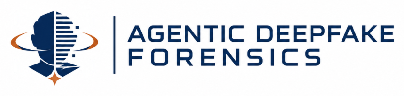
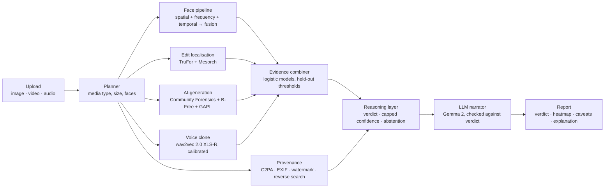

<div align="center">

<h1 align="center"></h1>

**Detectors decide, agents explain.**<br>
An evidence-grounded agentic system that checks images, videos and voice recordings for deepfakes,<br>
explains every verdict, and says *Cannot determine* when the evidence is too weak.


</div>

---

## Why this project

Most deepfake detectors answer one narrow question (*is this face swapped?*), return a bare probability, and are
evaluated in ways that can hide data leakage. A person who receives a suspicious file does not know which kind of
fake it might be. This system takes any image, video or audio file and:

1. **Routes** it to the right forensic tools (face pipeline, edit localisers, AI-generation detectors, voice-clone
   detector, provenance checks).
2. **Decides** with trained detectors only. Their scores are combined by small logistic models fitted on held-out data.
3. **Reasons** with a deterministic layer that caps confidence, attaches caveats and refuses to guess on weak evidence.
4. **Explains** the result in plain language through a local LLM, whose text is checked against the verdict.
5. **Verifies authenticity signals**: C2PA content credentials, EXIF consistency, invisible AI watermarks and
   reverse image search.

The language model never changes a verdict. Every component was kept only if it improved held-out results.

## Highlights

| What | Result |
|---|---|
| AI-generated images (AIGIBench) | **95.2%** caught at 5% false alarms, AUC **0.990** |
| AI-inpainted edits (CocoGlide) | **66.3%** caught, more than double the best single tool (29.0%) |
| AI-generated videos (GenVideo) | **85.8%** caught at 4.0% false alarms, AUC 0.979 |
| Cloned voices (In-the-Wild) | **78.4%** caught at 4.7% false alarms; AUC **0.978** out of distribution |
| Face swaps (FaceForensics++ c23) | **92.2%** accuracy with three-branch fusion, half the false positives of any single branch |
| Leakage-audited retraining (DF40) | found **128 of 140** validation videos leaking into training; clean retraining raised AUC 0.731 → **0.992** |
| Lip-sync forgeries (LipSync-A) | evaluated audio-visual detector reaches AUC **0.997** on generators it never saw |

All numbers come from the files in [`results/`](results/) and are reported in the accompanying paper.

## How it works



| Component | Role | Code |
|---|---|---|
| Planner and face pipeline | detects and tracks faces (RetinaFace + DeepSORT), runs three trained branches and the fusion MLP | [`agent/inference_engine.py`](agent/inference_engine.py), [`models/`](models/), [`preprocessing/`](preprocessing/) |
| Reasoning layer | branch audits, confidence caps, *Inconclusive* / *Cannot determine*, grounded LLM explanation | [`agent/agentic_reasoning.py`](agent/agentic_reasoning.py) |
| Evidence tools | wrappers around published detectors with their released weights | [`detectors/`](detectors/) |
| Pixel and provenance checks | error-level analysis, noise and spectrum maps, metadata and C2PA parsing, reverse image search | [`backend/`](backend/) |
| API | FastAPI job queue, accounts, history | [`backend/forensics_api.py`](backend/forensics_api.py) |
| Web app | upload, live analysis steps, heatmaps, history | [`frontend/`](frontend/) |

## Repository layout

```
agentic-deepfake-forensics/
├── agent/            planner, face pipeline orchestration, reasoning layer
├── backend/          FastAPI service, pixel forensics, metadata/C2PA, reverse search, storage
├── detectors/        evidence tools: AI-image, edit localisation, voice, watermark, EXIF
├── frontend/         Next.js web app
├── models/           face branches (spatial, frequency, temporal) and fusion: model + training code
├── preprocessing/    video decoding, face detection, tracking, cropping, quality checks
├── experiments/      benchmark downloads, evaluations, leakage-audited retraining (retrain/)
├── results/          per-item scores and summaries behind every reported number
├── docs/             training notes
├── run_app.bat       start backend + frontend (Windows)
├── run_app.sh        start backend + frontend (Linux/macOS)
└── setup_windows.bat one-time environment setup (Windows)

# created locally, not in git (see Setup)
├── third_party/      official code of the published detectors
├── weights/          pretrained/ (third-party) and trained/ (ours)
└── data/             benchmarks, training frames, test media
```

## Setup

**Requirements:** Python 3.10, Node.js 18+, about 6 GB of GPU memory recommended (CPU works, slowly).
[Ollama](https://ollama.com) with `gemma2:2b` is optional; without it, explanations fall back to rule-based text.

### 1. Environment

```bat
setup_windows.bat
```

This creates `.venv-win`, installs PyTorch (CUDA build if an NVIDIA GPU is present) and
[`requirements-windows.txt`](requirements-windows.txt), then installs the frontend packages.
On Linux, install [`requirements.txt`](requirements.txt) into a virtual environment and run `npm ci` in `frontend/`.

### 2. Third-party detector code

Clone each repository into `third_party/<name>` at the commit we used:

| Folder | Repository | Commit | Licence |
|---|---|---|---|
| `trufor` | [grip-unina/TruFor](https://github.com/grip-unina/TruFor) | `ae54475` | research, non-commercial |
| `mesorch` | [scu-zjz/Mesorch](https://github.com/scu-zjz/Mesorch) | `33454cb` | MIT |
| `commfor` | [JeongsooP/Community-Forensics](https://github.com/JeongsooP/Community-Forensics) | `ee5b71d` | MIT |
| `bfree` | [grip-unina/B-Free](https://github.com/grip-unina/B-Free) | `c6a9f89` | research, non-commercial |
| `gapl` | [UltraCapture/GAPL](https://github.com/UltraCapture/GAPL) | `ea32aeb` | see repository |
| `spai` | [mever-team/spai](https://github.com/mever-team/spai) | `8ff7b3b` | Apache-2.0 |
| `lipda` | [AnsonShe/LipDA](https://github.com/AnsonShe/LipDA) | `3589578` | MIT |
| `syncnet` | [joonson/syncnet_python](https://github.com/joonson/syncnet_python) | `907c0b5` | MIT |
| `lipinc` | [skrantidatta/LIPINC-V2](https://github.com/skrantidatta/LIPINC-V2) | `6d63dd7` | see repository |
| `safire` | [mjkwon2021/SAFIRE](https://github.com/mjkwon2021/SAFIRE) | `ec2af6a` | see repository |

```bash
git clone https://github.com/grip-unina/TruFor third_party/trufor && git -C third_party/trufor checkout ae54475
# ...repeat for the others
```

Only TruFor, Mesorch, Community Forensics, B-Free and GAPL are needed to run the app. The rest are used by
`experiments/`.

### 3. Weights

| Path | Source |
|---|---|
| `weights/trained/` (spatial, frequency, temporal, fusion) | our checkpoints, attached to the GitHub release |
| `weights/pretrained/trufor/trufor.pth.tar` | TruFor repository (download link in its README) |
| `weights/pretrained/mesorch/mesorch-98.pth` | Mesorch repository (download link in its README) |
| `weights/pretrained/bfree/BFREE_dino2reg4/` | B-Free repository |
| `weights/pretrained/gapl/checkpoint.pt` | [AbyssLumine/GAPL](https://huggingface.co/AbyssLumine/GAPL) on Hugging Face |
| Community Forensics, voice model | downloaded automatically from Hugging Face on first run |

### 4. Run

```bat
run_app.bat
```

The backend starts on `http://localhost:8001` and the web app opens at `http://localhost:3333`.
Reverse image search is optional and needs a SerpAPI key in `.env` (`SERPAPI_KEY=...`).

## Reproducing the paper

Every table can be regenerated from the scripts in [`experiments/`](experiments/); per-item scores are already in
[`results/`](results/).

| Paper section | Script | Output |
|---|---|---|
| AI-generated images | `experiments/eval_aigibench_all.py` | `results/benchmarks/aigibench_*` |
| AI-edited images | `experiments/eval_combined_all.py` | `results/benchmarks/combined_*` |
| Videos and voices | `experiments/eval_video_combined.py`, `experiments/eval_voice.py` | `results/benchmarks/` |
| Out-of-distribution test | `experiments/eval_omnifake_ood.py` | `results/benchmarks/omnifake_*` |
| Lip-sync | `experiments/eval_lipsync.py` | `results/benchmarks/lipsync/` |
| Leakage audit and DF40 retraining | `experiments/retrain/` | `results/retrain/` |

Run every script from the repository root, for example:

```bat
.venv-win\Scripts\python.exe experiments\eval_lipsync.py lipda syncnet
```

Benchmarks are downloaded by the matching `experiments/fetch_*.py` script, except FaceForensics++ and DF40, which
require a request to their authors.

## Responsible use

- *No traces found* is **not** proof that a file is authentic. The system never certifies media as real.
- Detectors fail on generators unlike their training data. The reasoning layer caps confidence for that reason, and
  we report false-positive rates alongside recall because false alarms can harm the people depicted.
- Use the results as evidence for a human decision, not as a final judgement.

## Citation

The paper is under review. Until it is published, please cite:

```bibtex
@unpublished{gupta2026agentic,
  title  = {Detectors Decide, Agents Explain: An Evidence-Grounded Agentic Framework for
            Multi-Modal Deepfake Forensics with Leakage-Audited Evaluation},
  author = {Gupta, Mayank and N, Sai Disha and Jaikanthan, Vibha and S Mugali, Nidhi and Malakreddy A, Bharathi},
  note   = {Manuscript under review},
  year   = {2026}
}
```

## Authors

Department of Artificial Intelligence and Machine Learning, BMS Institute of Technology and Management, Bengaluru.
All authors contributed to the study conception. Contributions as stated in the paper:

| Author | ORCID | Contribution |
|---|---|---|
| Mayank Gupta | [0009-0008-2604-8519](https://orcid.org/0009-0008-2604-8519) | extension of the concept (evidence-grounded agents, multi-detector design, leakage audit), methodology, design and implementation of the agentic framework and the multi-modal evidence tools, retraining study, statistical analysis, audio deepfake detection, lip-sync detection and evaluation, user interface, writing (original draft) |
| Sai Disha N | [0009-0009-2443-5109](https://orcid.org/0009-0009-2443-5109) | implementation and refactoring of the agent system, integration of the multi-modal evidence tools, leakage audit, training of the temporal and frequency branches, multi-branch fusion model |
| Nidhi S Mugali | [0009-0001-5676-0848](https://orcid.org/0009-0001-5676-0848) | training of the spatial branch, multi-branch fusion model, investigation |
| Vibha Jaikanthan | [0009-0006-7693-7600](https://orcid.org/0009-0006-7693-7600) | preprocessing pipeline, audio preprocessing, lip-sync analysis modules, software testing |
| Bharathi Malakreddy A | [0000-0002-8456-3227](https://orcid.org/0000-0002-8456-3227) | supervision, project administration, writing (review and editing) |

## Acknowledgements

This work builds on the released code, weights and data of TruFor, Mesorch, Community Forensics, B-Free, GAPL,
SPAI, LipDA, SyncNet, LIPINC-V2, FaceForensics++, DF40, AIGIBench, CocoGlide, GenVideo, In-the-Wild, OmniFake and
LipSync-A. Their licences apply to the corresponding components.
